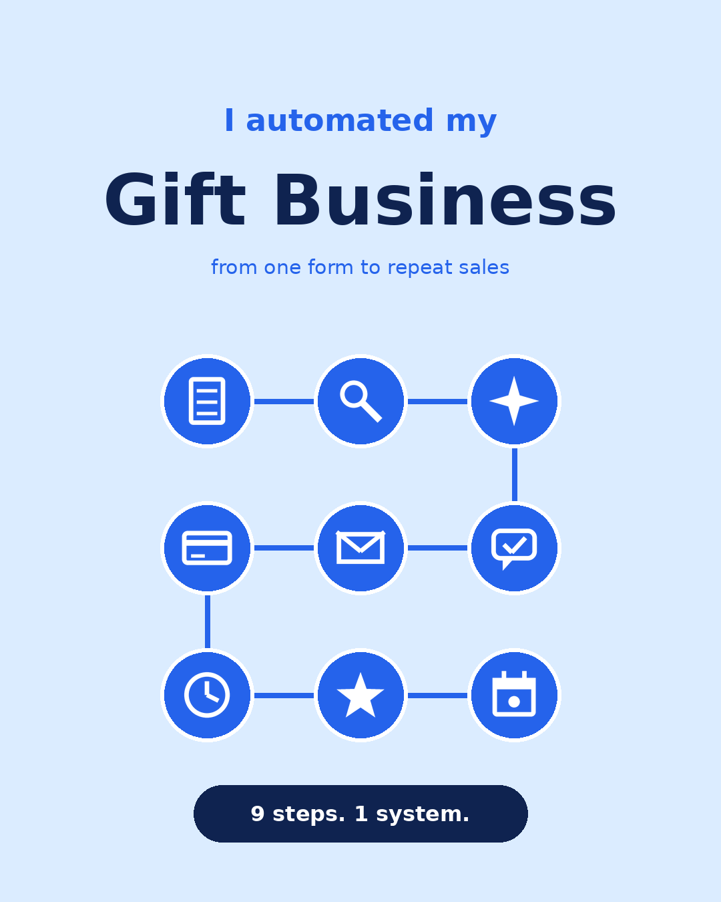
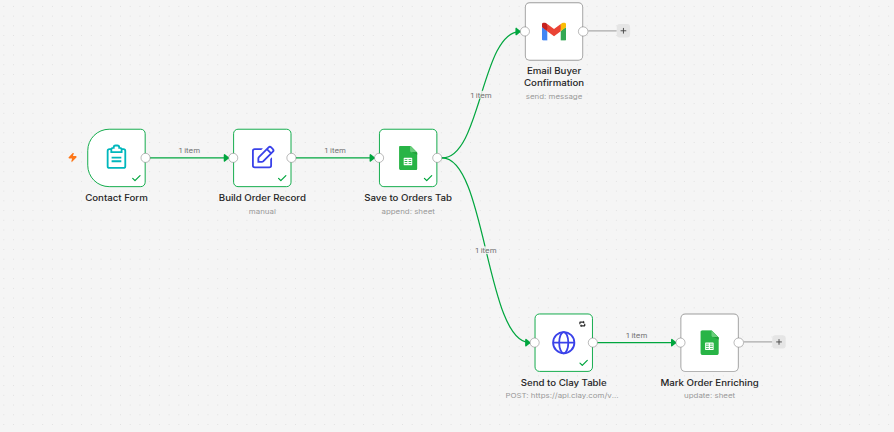
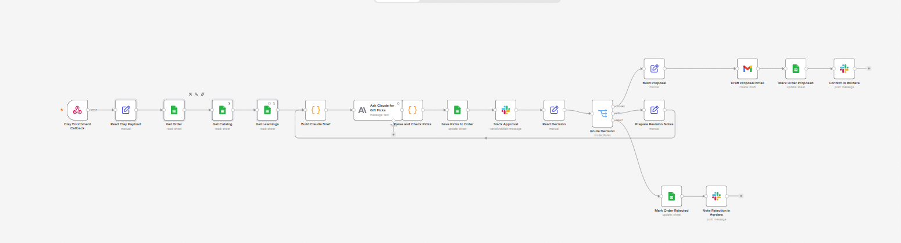
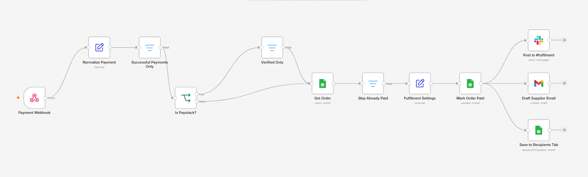

# Gift order automation

**An automated gift business, from one form to repeat sales. A buyer fills in a form, Clay enriches the recipient, Claude picks gifts from the catalog, a human approves in Slack, the buyer gets a proposal, and once payment clears, fulfilment and the supplier are lined up automatically.**

It's three n8n workflows sharing one Google Sheet (Orders, Catalog, Learnings and Recipients tabs) as the database.

## 1. Order intake

| Node | Does |
|---|---|
| **Contact Form** | n8n form trigger: who the gift is for, occasion, budget |
| **Build Order Record** | Shapes the submission into an order row |
| **Save to Orders Tab** | Appends it to the Orders sheet |
| **Email Buyer Confirmation** | Confirms to the buyer straight away |
| **Send to Clay Table** | POSTs the recipient to a Clay table for enrichment |
| **Mark Order Enriching** | Sets the order status so it's clear what stage it's in |

## 2. Gift picks with human approval

| Node | Does |
|---|---|
| **Clay Enrichment Callback** | Webhook Clay calls once the recipient is enriched |
| **Read Clay Payload** → **Get Order** | Joins the enrichment back to the order |
| **Get Catalog** + **Get Learnings** | Loads what's in stock, plus the Learnings tab of past decisions |
| **Build Claude Brief** | Code node that assembles order, recipient, catalog and learnings into one prompt |
| **Ask Claude for Gift Picks** | Claude chooses gifts from the catalog for this person |
| **Parse and Check Picks** | Code node that validates the picks against the catalog and budget before anyone sees them |
| **Save Picks to Order** | Writes the picks to the order row |
| **Slack Approval** | Send-and-wait message: a human approves, asks for a revision, or rejects |
| **Read Decision** → **Route Decision** | Three branches: |
| ↳ *chosen* | **Build Proposal** → **Draft Proposal Email** → **Mark Order Proposed** → **Confirm in #orders** |
| ↳ *revise* | **Prepare Revision Notes** → loops back to **Build Claude Brief** with the feedback |
| ↳ *reject* | **Mark Order Rejected** → **Note Rejection in #orders** |

## 3. Payment → fulfilment

| Node | Does |
|---|---|
| **Payment Webhook** | Receives payment events |
| **Normalize Payment** | One shape regardless of provider |
| **Successful Payments Only** | Drops failed and pending events |
| **Is Paystack?** → **Verified Only** | Paystack events must also be verified before they count |
| **Get Order** → **Skip Already Paid** | Idempotent: a retried webhook can't double-process an order |
| **Fulfilment Settings** | Loads fulfilment config |
| **Mark Order Paid** | Updates the order row |
| **Post to #fulfilment** | Tells the team to ship |
| **Draft Supplier Email** | Drafts the order to the supplier |
| **Save to Recipients Tab** | Upserts the recipient so their occasion and history are there for repeat sales |

## Design choices

- **AI proposes, a human decides.** Claude does the slow part (matching a person to a catalog), and a Slack button keeps a human in charge of what gets sent.
- **Revisions loop, they don't restart.** "Revise" sends the feedback back into the brief, so the next set of picks improves on the last.
- **Validate model output in code.** Picks are checked against the real catalog and budget before a human sees them.
- **Payments are idempotent.** Successful-only, verified-only and skip-already-paid filters mean a duplicate webhook can't trigger a second fulfilment.
- **Recipients become a list for repeat sales.** Every gift sent builds a list of people and occasions to come back to.
