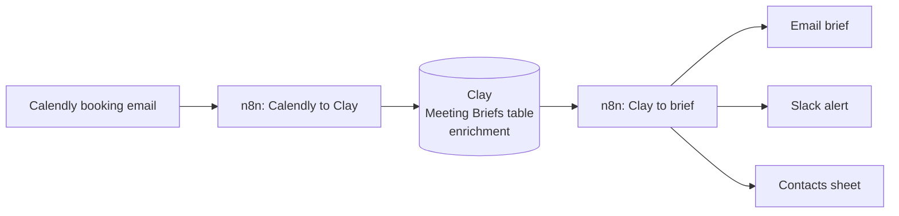
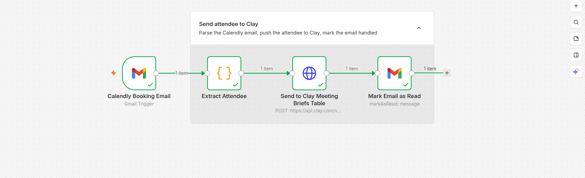
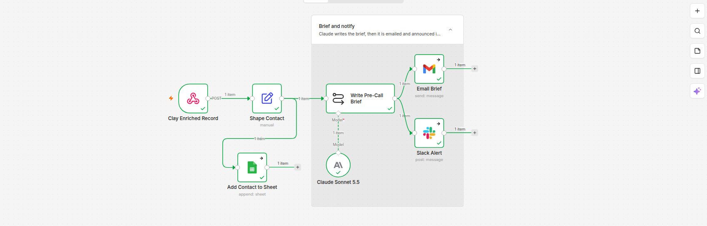

# Meeting brief pipeline

**Someone books a call on Calendly. Before the meeting, a one-page brief on that person and their company is in your inbox and on Slack. It's two n8n workflows with Clay doing the enrichment in between.**

## Part 1: Calendly → Clay

| Node | Does |
|---|---|
| **Calendly Booking Email** | Gmail trigger on Calendly's booking confirmation |
| **Extract Attendee** | Code node that parses the email for the attendee's name, email and company |
| **Send to Clay Meeting Briefs Table** | HTTP POST to the Clay table's webhook, which kicks off enrichment |
| **Mark Email as Read** | Marks the booking as handled |

## Part 2: Clay → brief

| Node | Does |
|---|---|
| **Clay Enriched Record** | Webhook Clay calls once enrichment is done |
| **Shape Contact** | Maps Clay's columns into a clean contact object |
| **Add Contact to Sheet** | Appends the contact to the contacts sheet |
| **Write Pre-Call Brief** | Claude Sonnet 5.5 writes the brief from the enriched record |
| **Email Brief** | Sends the brief by email |
| **Slack Alert** | Posts the brief to Slack |

## Why split it in two

Clay enrichment is asynchronous: waterfalls and lookups take time. Rather than polling, part 1 hands off to Clay and finishes, and Clay calls part 2 when the record is ready. Neither workflow sits waiting, and each one can be tested on its own.
