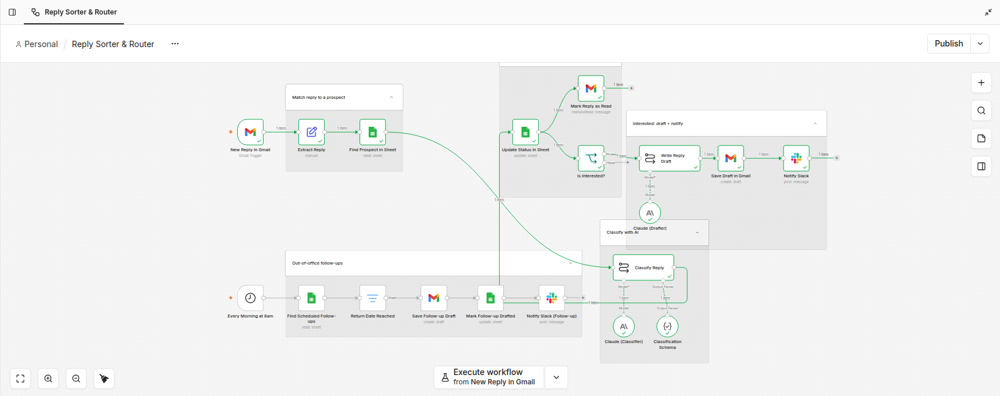

# Reply Sorter & Router

**Every reply that lands in Gmail is matched to the prospect it came from, classified by Claude, logged in the tracking sheet, and routed. Interested replies get a reply drafted and the team pinged on Slack. Out-of-office replies get a follow-up drafted automatically on the day the person is back.**

## Flow

### 1. Match reply to a prospect
| Node | Does |
|---|---|
| **New Reply in Gmail** | Gmail trigger on incoming replies |
| **Extract Reply** | Pulls sender, subject and the reply text, without the quoted thread |
| **Find Prospect in Sheet** | Looks the sender up in the prospect sheet, so every reply is tied to a known lead |

### 2. Classify with AI
| Node | Does |
|---|---|
| **Classify Reply** | Claude (classifier) reads the reply and returns a category |
| **Classification Schema** | Structured output parser, so the result is always valid JSON that later nodes can branch on |

### 3. Update and route
| Node | Does |
|---|---|
| **Update Status in Sheet** | Writes the category back to the prospect's row |
| **Mark Reply as Read** | Clears it from the inbox so nothing gets handled twice |
| **Is Interested?** | Only interested replies continue to drafting |

### 4. Interested: draft + notify
| Node | Does |
|---|---|
| **Write Reply Draft** | Claude (drafter) writes the response |
| **Save Draft in Gmail** | Saved as a **draft**, not sent. A human reviews it and hits send |
| **Notify Slack** | Tells the team there's a hot reply waiting |

### 5. Out-of-office follow-ups (scheduled)
| Node | Does |
|---|---|
| **Every Morning at 8am** | Schedule trigger |
| **Find Scheduled Follow-ups** | Reads leads whose OOO reply gave a return date |
| **Return Date Reached** | Filter: only people who are back today |
| **Save Follow-up Draft** | Drafts the follow-up in Gmail |
| **Mark Follow-up Drafted** | Updates the sheet so it never drafts the same follow-up twice |
| **Notify Slack (Follow-up)** | Lets the team know drafts are ready |

## Design choices

- **Two Claude calls, two jobs.** One model classifies and a separate one drafts. Each prompt does one thing, so each is easier to tune.
- **Drafts, not auto-sends.** Claude writes, a human sends. You save the writing time and still review every reply.
- **The sheet is the source of truth.** Every reply updates the prospect's status, and every follow-up is marked as drafted. You can see the state of the whole campaign in one place.
- **Out-of-office replies aren't dead ends.** A return date becomes a scheduled follow-up instead of a lost lead.
